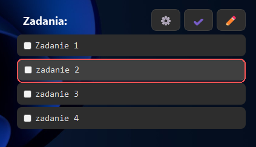

<div align="center">

# 📝 Lista Zadań AI

**Minimalistyczny, przezroczysty widget To-Do na pulpit Windows (PyQt5) z wbudowanym asystentem AI (Google Gemini).**

[](https://github.com/Dawe1600/Lista_Zadan/actions/workflows/ci.yml)
[](https://github.com/Dawe1600/Lista_Zadan/releases/latest)
[](https://www.python.org/)
[](https://github.com/Dawe1600/Lista_Zadan/releases)
[](https://github.com/astral-sh/ruff)
[](LICENSE)

<br />



</div>

---

## ✨ Główne funkcje

* **Asystent AI (Google Gemini):** Oznacz zadanie jako ważne i skorzystaj z menu kontekstowego, aby AI wygenerowało 3 konkretne kroki pomagające ruszyć z miejsca.
* **Przezroczysty interfejs bez ramek (Frameless Dark Mode):** Okno wtapia się w pulpit i można je swobodnie przeciągać za dowolne puste miejsce.
* **Drag & Drop:** Wygodna zmiana kolejności aktywnych zadań poprzez przeciąganie i upuszczanie.
* **Zarządzanie zadaniami:** Dodawanie, edycja, oznaczanie ważności, opcjonalne dłuższe opisy oraz usuwanie zadań.
* **Historia zadań:** Dedykowany widok ukończonych zadań z możliwością ich szybkiego przywrócenia.
* **Autostart w Windows:** Opcjonalne uruchamianie widgetu wraz ze startem systemu (ustawienia zapisywane w Rejestrze Windows).

---

## 📥 Instalacja (dla użytkowników)

Nie musisz mieć zainstalowanego Pythona, aby korzystać z aplikacji:

1. Przejdź do zakładki **[Releases](https://github.com/Dawe1600/Lista_Zadan/releases/latest)**.
2. Pobierz najnowszy instalator `ToDoList-Setup-v*.exe`.
3. Uruchom instalator — podczas konfiguracji możesz od razu włączyć funkcje AI.
4. Jeśli włączasz AI, wklej swój klucz **Google Gemini API** (możesz go wygenerować w [Google AI Studio](https://aistudio.google.com/)).
5. Gotowe! Aplikacja pojawi się na pulpicie.

---

## 🛠️ Dla programistów

### Wymagania

* **Python 3.10+**
* **Windows** (integracja z autostartem i ustawieniami korzysta z Rejestru Windows)

### Uruchomienie ze źródeł

```bash
# Sklonuj repozytorium
git clone https://github.com/Dawe1600/Lista_Zadan.git
cd Lista_Zadan

# Utwórz i aktywuj środowisko wirtualne
python -m venv .venv
.venv\Scripts\activate

# Zainstaluj pakiet wraz z narzędziami deweloperskimi
pip install -e ".[dev]"

# Uruchom aplikację
python -m lista_zadan
# (alternatywnie: python main.py)
```

### Lint i testy

CI uruchamia automatycznie na `windows-latest`:

```bash
# Sprawdzenie jakości kodu (ruff)
ruff check src tests

# Testy jednostkowe (w trybie offscreen dla PyQt5)
# PowerShell:
$env:QT_QPA_PLATFORM="offscreen"; python -m unittest discover -s tests -v
```

---

## 🧩 Architektura projektu

```text
Lista_Zadan/
├── src/lista_zadan/
│   ├── __main__.py       # Punkt wejścia (python -m lista_zadan)
│   ├── logic.py          # Główne okno widgetu (ListaZadan), obsługa UI i zdarzeń
│   ├── task_store.py     # Model Task oraz warstwa persystencji zadań (JSON)
│   ├── dialogs.py        # Okna dialogowe (edycja, historia, pomoc AI z workerem QThread)
│   ├── app_settings.py   # Ustawienia aplikacji i integracja z Rejestrem Windows
│   └── styles.py         # Style QSS i niestandardowe malowanie/animacje
├── tests/                # Testy jednostkowe i geometrii widgetu
├── packaging/            # Konfiguracja PyInstaller i Inno Setup
├── docs/                 # Dokumentacja projektu i zasoby wizualne
├── CODING_STANDARDS.md   # Zasady architektury i przeglądów kodu
└── GLOSSARY.md           # Słownik pojęć domenowych
```

---

## 🤝 Współpraca i licencja

* Chcesz pomóc w rozwoju projektu? Zajrzyj do [CONTRIBUTING.md](CONTRIBUTING.md).
* Projekt udostępniany jest na licencji **[MIT](LICENSE)**.
